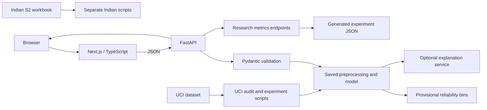

# AutInsight

**An Explainable AI-Driven Pediatric Autism Spectrum Disorder Screening System for Children** is a research project for auditing questionnaire-based screening data, evaluating machine-learning baselines, and communicating uncertainty and limits. It is not a diagnostic system, clinical decision-support product, validated screening instrument, or substitute for qualified assessment.

## Research motivation and objectives

The project studies whether machine-learning approaches can support questionnaire-based ASD screening, how individual predictions can be explained, whether explanations are useful and stable, how subgroup performance varies, and how an application can defer when evidence is weak. Its central research risks are target circularity, narrow populations, leakage, inadequate calibration, sparse subgroup samples, and readers mistaking a screening classification for a diagnosis.

The actual UCI audit confirms serious label circularity. A separate Indian AIIMS modified INDT-ASD validation dataset is publicly available and analyzed independently. No result should be interpreted as clinical model validation.

## Status summary

| Area | Status |
|---|---|
| Data acquisition | UCI 419 and PLOS 2019 S2 Indian supplement acquired with checksums/provenance; raw files git-ignored |
| Data audit and EDA | Schema, missingness, duplicate, target and plots generated from both real sources |
| Comparative models | Logistic Regression and Random Forest trained separately for each dataset |
| XGBoost | Trained primary model, saved as `models/primary.joblib` with checksum manifest |
| UCI label validity | Deterministic circularity verified: `result = sum(A1…A10)`, and `class=YES` iff `result >= 7` |
| Indian analysis | Separate 2019 validation cohort: 225 children, 53 columns, DSM-5 gold-standard target; exploratory holdout baselines |
| SHAP/counterfactual | XGBoost TreeSHAP explainer saved in primary artifact and returned by API; comparative RF global/local TreeSHAP has additivity check; counterfactuals deferred |
| Reliability/fairness | Exploratory uncalibrated probability bins and subgroup summaries for baselines; no validated policy or fairness claim |
| Frontend/API | Caregiver-first questionnaire → observations → result flow; FastAPI XGBoost explanation API |
| Verification | Prior backend tests and production build passed; current UI revision passes source TypeScript and ESLint checks; see below |
| Deployment | Local/container/Vercel configuration prepared; no cloud deployment or URL |

The Phase I Review II presentation named in the prompt was not present in the workspace, so the supplied prompt is the available specification.

## Architecture



Browser → Next.js on Vercel → FastAPI backend → validated request → saved preprocessing/model → reliability categorization → structured result. The frontend never re-creates predictions. Research scripts and datasets are separate from the web runtime. UCI and Indian datasets are never pooled.

### Technology choices

- **Next.js 16 App Router, React 19, TypeScript:** responsive, independently deployable frontend; routes are under `frontend/src/app/`.
- **FastAPI, Pydantic:** authoritative API validation, health/readiness, model metadata, predictions, and generated research summaries.
- **Pandas, NumPy, scikit-learn:** tabular audit, train-only preprocessing, pipelines, baselines, metrics and subgroup analysis.
- **XGBoost:** trained primary model; macOS requires OpenMP (`brew install libomp`). A checksum-verified runtime was used locally for model training and API verification. The Linux container was not built here.
- **SHAP:** primary XGBoost artifact includes TreeSHAP and the API returns local contributions. Comparative UCI Random Forest global/local explanations and an additivity reconstruction check are saved in metrics; no explanation stability/fidelity evaluation is available.
- **Recharts:** experiment-driven model comparison chart.
- **Pytest/HTTPX, Ruff, ESLint/TypeScript:** API and code checks.
- **Docker/Vercel:** backend container and separately hosted frontend configuration. Streamlit was an alternative mentioned in the project brief; Next.js was selected per the finalized architecture.

## Data and validity findings

### UCI child questionnaire dataset

Source: [UCI dataset 419](https://archive.ics.uci.edu/dataset/419/autistic%2Bspectrum%2Bdisorder%2Bscreening%2Bdata%2Bfor%2Bchildren), DOI 10.24432/C5659W, CC BY 4.0. Acquisition: `python scripts/download_data.py`; provenance and SHA-256 are written to `data/raw/provenance.json`. The source record has 292 rows and 20 features; the acquired raw CSV has 21 columns including its target.

Audit: 292 records, `class` NO=151 / YES=141; age missing=4; ethnicity missing=43; relation/respondent missing=43; 2 exact duplicate rows. The 2 duplicates are removed before train/test splitting. `result` and constant `age_desc` are excluded from features. The audit verified every row satisfies `result == sum(A1_Score…A10_Score)` and `class=YES` exactly when `result >= 7`. Therefore, performance with A1–A10 measures reconstruction of the questionnaire’s score rule, not independent detection of ASD. The direct threshold rule is included as a baseline and yields 100% agreement with the dataset label by construction. A demographic-only sensitivity model is also reported.

Source fields, preprocessing and target semantics are detailed in [docs/data_dictionary.md](docs/data_dictionary.md). EDA outputs include class distribution, age, missingness and questionnaire response summaries in `experiments/figures/`.

### Indian AIIMS Modified INDT-ASD validation data

Source: PLOS ONE 2019, “Development and validation of DSM-5 based diagnostic tool for children with Autism Spectrum Disorder,” supporting information S2, via [PLOS article](https://journals.plos.org/plosone/article?id=10.1371%2Fjournal.pone.0213242) and [Figshare record](https://plos.figshare.com/articles/dataset/Development_and_validation_of_DSM-5_based_diagnostic_tool_for_children_with_Autism_Spectrum_Disorder/7840055). The article reports 225 children aged 1–14 enrolled at a North Indian tertiary referral hospital after suspected-ASD criteria; 128 were diagnosed ASD and 97 non-ASD by expert consensus. The publicly released S2 workbook is 225×53, deidentified, CC BY 4.0. Acquisition verifies the DOI, license and MD5: `python scripts/download_indian_data.py`.

The secondary experiment uses the 28 modified INDT-ASD item columns, age in months, gender, SES and residence. It excludes patient IDs, old/new tool result summaries, section outcomes, severity measures, CARS, DP3 and the DSM-5 target. It maps source target 1→ASD and 2→non-ASD, matching published counts. The S2 workbook is the 2019 validation cohort. It is not assumed to be identical to the AMI dataset referenced in the 2024 arXiv paper. Its questionnaire and target differ from UCI; results are analyzed separately and not directly compared.

The cohort is selected from suspected cases at a tertiary center, which creates spectrum and selection limits. The dataset is not a population screening sample. See `experiments/reports/indian_data_quality.json`.

## Modeling and actual results

Both scripts use one stratified 75/25 split, seed 17, and train-only imputation/encoding/scaling inside scikit-learn pipelines. This is exploratory and not a final confirmatory study. A single 73-record UCI or 56-record Indian test set yields substantial uncertainty; nested/repeated validation and external validation are needed.

### UCI, deduplicated n=290 (217 train, 73 test)

| Experiment | Accuracy | Balanced accuracy | F1 | ROC AUC | Brier |
|---|---:|---:|---:|---:|---:|
| Logistic Regression | 0.973 | 0.974 | 0.972 | 1.000 | 0.019 |
| Random Forest | 0.945 | 0.944 | 0.941 | 0.989 | 0.094 |
| XGBoost (primary) | 0.973 | 0.973 | 0.971 | 0.998 | 0.037 |
| Demographics-only Logistic Regression | 0.534 | 0.533 | 0.514 | 0.583 | 0.248 |
| Explicit `sum(A1…A10) >= 7` rule | 1.000 | 1.000 | 1.000 | — | — |

The high full-feature results are expected because the label is defined from the questionnaire score. They are not clinical performance. XGBoost was trained, but the result remains a reproduction of the same circular source label, not diagnostic performance.

### Indian S2 cohort, n=224 analyzed (168 train, 56 test)

| Experiment | Accuracy | Balanced accuracy | F1 | ROC AUC | Brier |
|---|---:|---:|---:|---:|---:|
| Logistic Regression | 0.857 | 0.849 | 0.879 | 0.945 | 0.088 |
| Random Forest | 0.893 | 0.880 | 0.912 | 0.967 | 0.073 |

These are exploratory holdout results from a referral cohort and are not population-wide estimates. Complete figures and source subgroup counts are in `experiments/results/indian_model_metrics.json`.

### Reliability and subgroup results

The API’s P0/P1/P2/P3 categories use maximum class probability cutoffs 0.90/0.80/0.70; P2/P3 defer. These are uncalibrated engineering thresholds. Under those provisional bins, UCI XGBoost P0/P1 coverage was 75.3% with observed selective error 0/55; Logistic Regression coverage was 89.0% (0/65 errors) and Random Forest coverage was 37.0% (0/27 errors). These small-split observations do not validate thresholds. No reliability diagram, entropy, Jensen–Shannon divergence, cost-based policy, or calibration procedure is implemented.

The UCI subgroup report includes gender and ethnicity sample counts, accuracy, sensitivity and Wilson intervals. Ethnicity groups are often tiny; values are descriptive only. Indian results include gender-code strata with counts and Wilson sensitivity intervals. No fairness guarantee is claimed. Exact outputs are generated in the model metrics JSON.

## Explainability

The XGBoost artifact includes TreeSHAP and the prediction API returns local raw-score contributions. A comparative UCI Random Forest report includes global mean absolute SHAP values and one local held-out example; its base value plus contributions reconstructed positive-class probability with absolute error 1.89e-15. The leading features were A1–A10, consistent with the known label rule. These explain model behavior, not causality or clinical reasoning. XGBoost explanation additivity was not independently verified. Explanation stability, perturbation fidelity, plausibility and usability were not evaluated. Counterfactual generation is not implemented. It requires domain-approved mutable-feature constraints, validation, and clinical review. Video analysis (OpenPose and TensorFlow/Keras CNN-LSTM) remains future work only.

## Caregiver-facing flow and API

The caregiver-facing app presents a simple journey: `/` introduces the tool and its limits, `/screening` guides caregivers through ten AQ-10 Child-Version-informed items and a structured developmental-observation assessment, and `/results` provides a caregiver summary, a feature-contribution explanation, and practical next steps. The results page links to `/results/understand`, which explains local TreeSHAP contributions, research figures, and analysis methods. Item wording is adapted for readability, so the resulting questionnaire experience is not a validated AQ-10 administration. The item order and 4-option scoring direction follow the child questionnaire source guide; source item wording/scoring is attributed [here](https://northdevoncoastalpcn.nhs.uk/media/hypg30xa/aq-10child-autism.pdf). Follow-up observations remain in the current browser tab and do not enter the ML model. The model receives age and the ten scored answers. Model output is explicitly described as reproduction of the UCI source-data label, not an independent likelihood estimate; probabilities are not shown to caregivers.

Research documentation and experiment reports remain in `docs/` and `experiments/` for academic review; those model-insights, reliability, fairness, and methodology pages were removed from the caregiver-facing navigation.

API endpoints:

| Method/path | Purpose |
|---|---|
| `GET /health` | Liveness (`{"status":"ok"}`) |
| `GET /ready` | Readiness; HTTP 200 when the saved model loads, otherwise HTTP 503 |
| `GET /model` | Model name/version/readiness |
| `GET /research/metrics` | UCI generated metrics JSON |
| `GET /research/indian-metrics` | Indian cohort generated metrics JSON |
| `POST /predict` | Validates ten 0/1 responses and context, predicts with saved pipeline, reliability tier, and SHAP output; HTTP 422 for invalid input |

`POST /predict` takes `age`, `gender`, `jaundice`, `family_asd`, and `questions` (10 binary integers); optional `ethnicity`, `who_completed`, `country`, and `used_app_before` have defaults. Pydantic returns 422 for invalid values. No authentication is configured. Do not send identifying information or real patient data.

## Setup and commands

Requirements: Python 3.11/3.12, Node.js ≥20.19 (Node 22 recommended), npm. On macOS install OpenMP for XGBoost: `brew install libomp`.

```bash
python3 -m venv .venv
source .venv/bin/activate                 # PowerShell: .venv\\Scripts\\Activate.ps1
pip install -r requirements.txt
python scripts/download_data.py
python scripts/validate_data.py
python scripts/run_eda.py
python scripts/train_models.py
python scripts/download_indian_data.py
python scripts/validate_indian_data.py
python scripts/run_indian_eda.py
python scripts/train_indian_models.py
pytest -q
ruff check backend scripts
uvicorn backend.app.main:app --reload
```

In another terminal:

```bash
cd frontend
npm ci
NEXT_PUBLIC_API_URL=http://localhost:8000 npm run dev
```

The checked-in artifact makes `/ready` return ready after the configured OpenMP runtime loads. API research endpoints also serve experiment results.

## Deployment

### Vercel frontend

Set project root to `frontend`, framework Next.js, build command `npm run build`, and `NEXT_PUBLIC_API_URL` to the deployed backend HTTPS origin. `frontend/vercel.json` supplies framework/build configuration. The frontend is not deployed from this workspace.

### FastAPI backend

Build from repository root with `docker compose up --build`; the versioned model artifact is included. `backend/Dockerfile` copies the app, model directory and generated research metrics. Set `MODEL_PATH` to the artifact path and `ALLOWED_ORIGINS` to the exact Vercel origin(s), comma-separated. `/health` checks liveness and `/ready` checks model loading. No cloud credentials, hosted service, or deployment URL were supplied; no remote deployment was performed.

### Environment variables

- `NEXT_PUBLIC_API_URL`: FastAPI origin consumed by Next.js browser code.
- `MODEL_PATH`: backend joblib bundle path.
- `ALLOWED_ORIGINS`: exact frontend origins; defaults to `http://localhost:3000,http://127.0.0.1:3000`.

## Verification performed

- UCI downloaded and checksum recorded; schema/data audit executed.
- Indian PLOS S2 file downloaded; license/DOI/MD5 verified; schema/data audit executed.
- UCI and Indian EDA scripts generated real charts/reports.
- Logistic Regression and Random Forest experiments executed on both datasets; XGBoost also trained on the primary UCI dataset; metrics saved.
- XGBoost trained with pinned dependencies and a local OpenMP runtime; `models/primary.joblib` and manifest generated.
- Backend tests: 4 passed, including loaded-artifact prediction/SHAP behavior, readiness, invalid schema rejection, and generated research metrics endpoints.
- Ruff: passed after formatting.
- Before the caregiver-flow redesign: frontend TypeScript check, ESLint and Next.js production build passed.
- Caregiver-flow revision: ESLint and a strict TypeScript check of all current source files passed. The ordinary `npm run typecheck` initially read stale generated `.next/types` entries for deleted pages; those generated types were cleared and the standard typecheck then passed. Restart the Next.js dev server to clear its own stale route cache. A production build and backend tests were not rerun after this UI revision.
- `npm audit`: zero vulnerabilities after replacing vulnerable Next ESLint config dependency.
- Earlier local smoke test with model artifact loaded: FastAPI health/readiness/metadata and both research endpoints returned 200; configured CORS preflight returned 200; invalid prediction returned 422; valid prediction returned 200 with five SHAP contributions. The old Next.js route set also returned 200. No cloud deployment was attempted.

## Privacy, security and safety

The browser sends only the child’s age and scored questionnaire answers to the configured FastAPI endpoint. Structured caregiver observations stay in the current browser tab and are included only in its sessionStorage report. The API does not persist request bodies or use analytics; hosting logs may contain operational metadata. CORS is allowlisted; authentication, rate limiting, formal retention policy and a privacy impact review are not implemented. Joblib must only load trusted artifacts. No names or other identifying information should be entered. This project has no clinical validation, regulatory review, ethics approval statement, or clinical deployment.

## Limitations and next work

1. Add repeated/nested evaluation, confidence intervals and external validation for the trained model; do not infer clinical validity from UCI scores.
2. Add repeated/nested validation and confidence intervals, calibration plots, decision-cost-based abstention thresholds, and external validation.
3. Evaluate explanation fidelity/stability and add a feasible, clinically reviewed counterfactual method.
4. Strengthen Indian analysis with repeated validation and appropriate external cohort; do not equate the 2019 S2 workbook with the 2024 AMI dataset without evidence.
5. Build responsive accessibility/end-to-end frontend tests and validate against the live API.
6. Complete privacy/security governance and expert oversight before any applied research.
7. Video analysis is explicitly future work; no OpenPose or CNN-LSTM implementation exists.

See `docs/methodology.md`, `docs/model_card.md`, `docs/data_dictionary.md`, `docs/reproducibility.md`, `docs/limitations.md`, `docs/threat_model.md`, `docs/architecture.md`, `docs/deployment.md`, and `docs/requirements_traceability.md` for detail.

For sharing the project as a ZIP, see [the teammate setup guide](docs/TEAMMATE_SETUP.md). The detailed technical companion PDF is saved at `output/pdf/AutInsight_Technical_Reference.pdf`.
