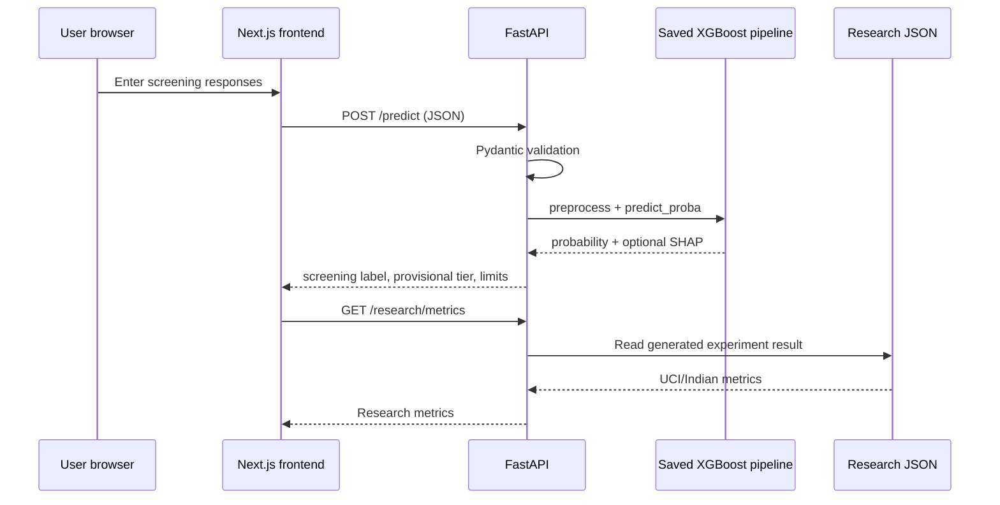

# Architecture

Frontend/backend deploy independently. Browser prediction request flow is Next.js → FastAPI → validated schema → saved preprocessing/model bundle → reliability categorization → optional explanation → JSON. The frontend never makes an authoritative prediction. `NEXT_PUBLIC_API_URL` configures browser-to-backend requests; `ALLOWED_ORIGINS` restricts FastAPI CORS origins.

Research scripts acquire and audit UCI and the Indian PLOS S2 workbook independently, fit dataset-specific preprocessing/model pipelines, and write metrics. Their target meanings and features are incompatible for pooling; the app's primary prediction schema is UCI only. The Indian work is a separate research analysis. A versioned XGBoost artifact is included and local `/ready` plus prediction have been verified with a compatible OpenMP runtime. Research JSON endpoints are independent of model loading.
